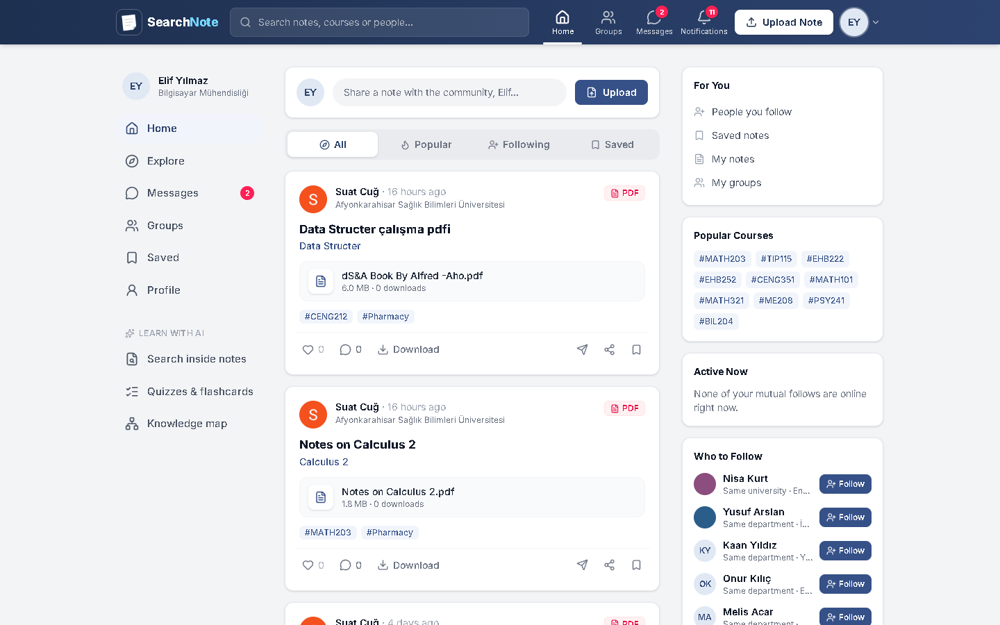
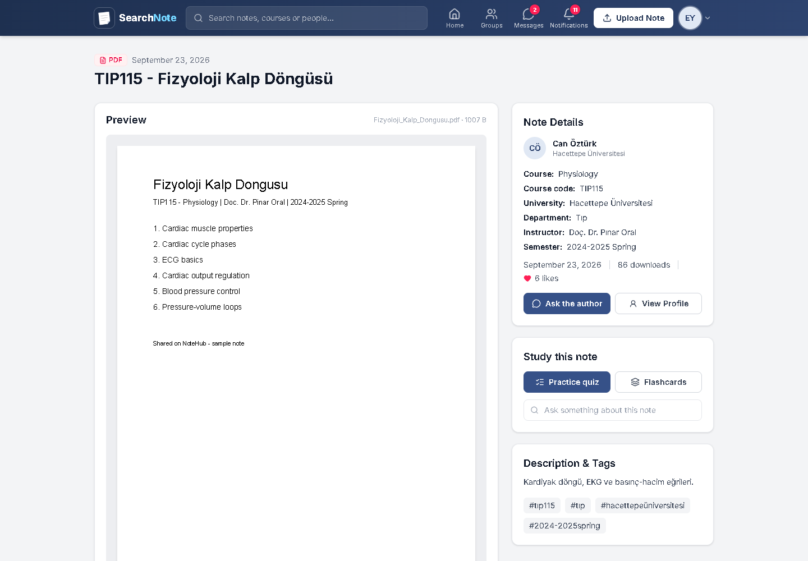
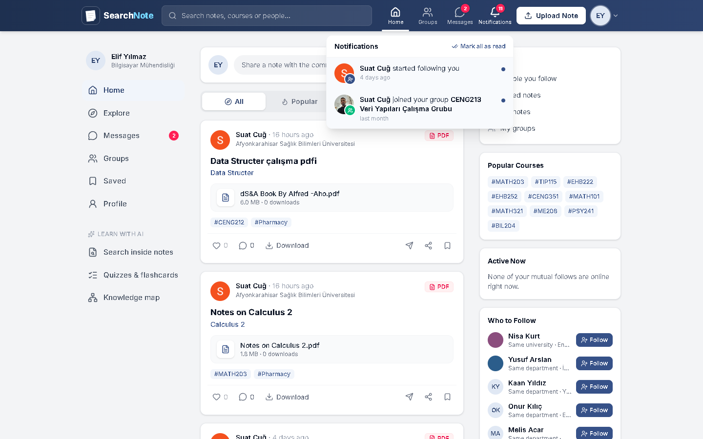
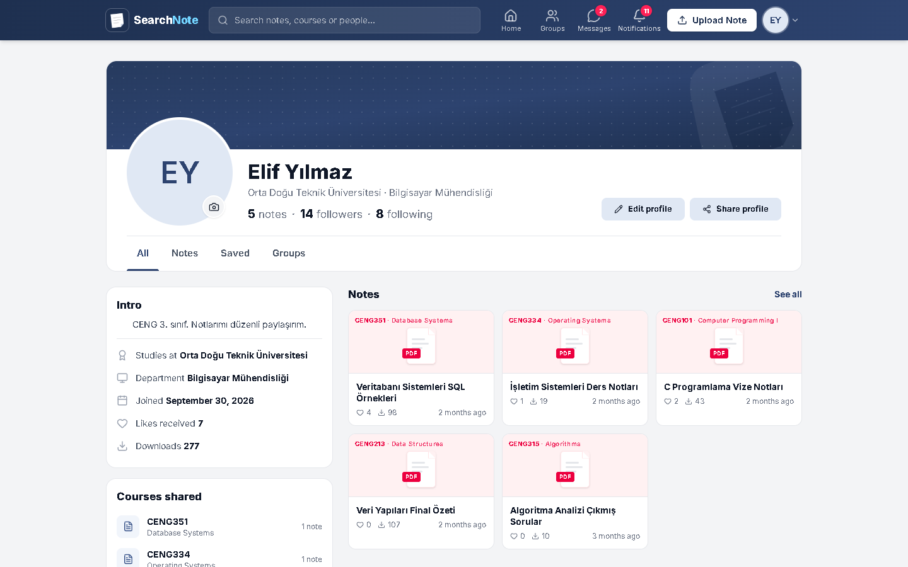
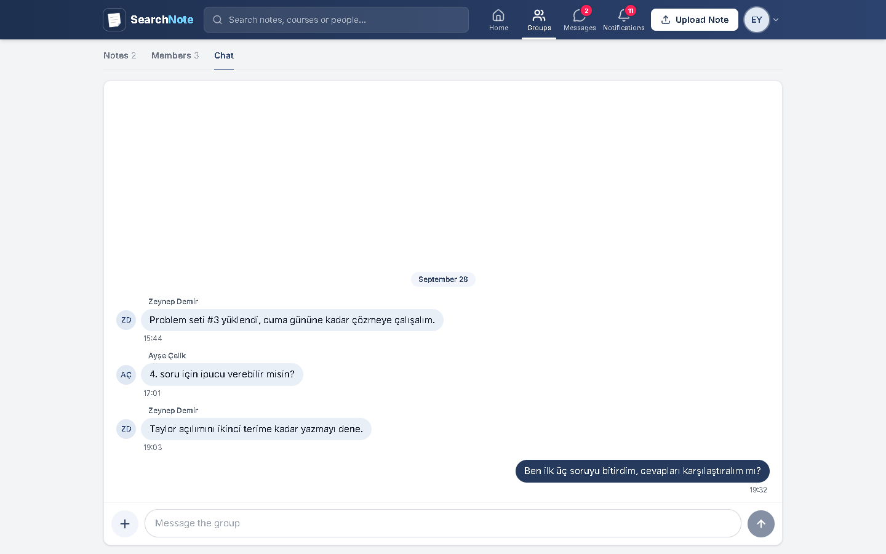

<div align="center">

# SearchNote 📚

**Üniversite öğrencilerinin ders notlarını paylaştığı, başkalarının notlarını
keşfettiği ve aynı dersleri çalışan insanlarla bağ kurduğu; sosyal akış, anlık bildirimler,
birebir mesajlaşma, çalışma grupları ve yapay zekâ destekli çalışma araçlarıyla birlikte gelen bir not paylaşım platformu.**

[Özellikler](#-özellikler) · [Ekran görüntüleri](#-ekran-görüntüleri) · [Teknolojiler](#-kullanılan-teknolojiler) · [Kurulum](#-yerelde-çalıştırma) · [Deploy](#️-deploy)


🔗 **Canlı demo:** [searchnote.netlify.app](https://searchnote.netlify.app/)

</div>

---

## Proje hakkında

SearchNote, sınav dönemlerinde herkesin aynı özetleri tekrar tekrar yazmasının ve aynı
çıkmış soruları aramasının önüne geçmek için tasarlandı. Bir öğrencinin hazırladığı iyi
bir not, aynı dersi alan herkesin işine yarasın diye platform üç fikir üzerine kurulu:

- **📤 Paylaş** – PDF, Word, görsel veya arşiv olarak notunu yükle; üniversite, bölüm,
  ders kodu, hoca ve dönem bilgileriyle etiketle. Notu herkesle, sadece takipçilerinle ya da
  bir çalışma grubuyla paylaş. Kredi ya da puan sistemi yok, indirme sınırsız ve ücretsiz.
- **🔎 Keşfet** – Sosyal medya düzenindeki akışta yeni ve popüler notları gör; ders,
  hoca, üniversite ya da yazar adıyla ara, filtrele, beğendiklerini kaydet.
- **🤝 Bağ kur** – Notların yazarlarını takip et, yorum yap, birebir mesajlaş, aynı
  dersi alanlarla çalışma grubu kur ve grup sohbetinde buluş.
- **🧠 Çalış** – Notların içinde ara ve soru sor; herhangi bir nottan — ya da kendi yüklediğin bir
  dosyadan — yapay zekâyla quiz ve flashcard üret, cevaplarınla kişisel bilgi haritanı oluştur.

Giriş yapmamış ziyaretçi hesap açmadan notları gezebilir, arayabilir ve önizleyebilir; profillere
ve gruplara bakabilir. Beğeni, yorum, kaydetme, indirme, takip, mesaj, not yükleme ve yapay zekâ
araçları ise giriş ister: bu butonlar ziyaretçiyi giriş sayfasına götürür, girişten sonra aynı sayfaya
dönülür. Yeni üyeler e-posta adreslerini doğrulamadan sitede gezemez.

> **Not:** Bu depo, çalışması için gerçek bir backend'e ihtiyaç duyar. Sahte/mock API
> katmanı yoktur; frontend, `VITE_API_URL` üzerinden Express + MongoDB API'sine bağlanır.
> Kurulum için [Yerelde çalıştırma](#-yerelde-çalıştırma) bölümüne bakın.

## ✨ Özellikler

**Not paylaşımı**
- PDF, DOCX, JPG/PNG ve ZIP/RAR yükleme (varsayılan en fazla 25 MB)
- Dosya içeriğinin imzasıyla uzantının karşılaştırılması — uzantısı değiştirilmiş dosyalar reddedilir
- PDF ve görseller için sayfa içi önizleme (pdf.js); önizleme indirme sayacını artırmaz
- Not düzenleme/silme
- **Görünürlük seçimi:** *Everyone* (herkes), *Followers only* (sadece takipçiler) ya da *A study group*
  (sadece grup üyeleri). Takipçilere özel notlar akışta, aramada, profilde, detay/indirme/önizlemede ve
  mesajla paylaşımda yalnızca yazarı takip edenlere görünür; kartlarda "Followers" rozetiyle işaretlenir

**🧠 Learn with AI**
- **Search inside notes (`/ask`):** yüklenen notların metni arka planda çıkarılır (PDF sayfa sayfa, DOCX;
  taranmış PDF ve fotoğraflar yapay zekâyla okunur) ve parçalar halinde indekslenir. Arama Türkçe + İngilizce
  metin indeksinde ve (Voyage anahtarı varsa) Voyage `voyage-4` + Atlas Vector Search ile anlamsal olarak
  yapılır; anlamsal sonuçlar benzerlik eşiğinin (`VECTOR_MIN_SCORE`) altındaysa alakasız sayılır
- **Sadece notlardan cevap:** yapay zekâ bulunan sayfaların soruyu gerçekten cevaplayıp cevaplamadığına karar
  verir (structured output: `covered`, `answer`, `sources`). Cevap varsa doğrudan yazılır ("notlara göre"
  gibi ifadeler olmadan, sorunun dilinde) ve altında **sadece dayandığı sayfalar** listelenir; notlarda yoksa
  "The notes don't cover that" görünür, alakasız sayfa gösterilmez ve günlük soru hakkı iade edilir. Dış
  bilgiyle cevap verilmez
- **Quizzes & flashcards (`/practice`):** ders kodu ya da konu yazıp not seç, 10 soruluk quiz ya da 15
  flashcard al. Her soru geldiği sayfayı gösterir; üretilen setler not başına saklanır (sonraki öğrenciler
  beklemeden açar). Quiz bitince "More questions on these topics" ile notla sınırlı olmayan konu pratiği turları
- **Kendi dosyanı yükle:** Quizzes & flashcards sayfasındaki *Upload your own file* ile PDF, DOCX ya da
  not fotoğrafı (JPG/PNG) yüklenir; dosya **sadece yükleyene görünür** (akış, Explore, profil, arama ve
  sayaçlarda çıkmaz, başkası bağlantıyla açarsa `404`). Sayfaları okununca quiz / flashcard açılır, istenince silinir
- **Knowledge map (`/knowledge`):** quiz cevaplarından konu bazında doğru / yanlış takibi; zayıf konular,
  onları besleyen temel konular ve çalışılacak not önerileri
- Maliyet kontrolü için kullanıcı başına günlük soru / set sınırı; API anahtarı yoksa arama yine çalışır

**👀 Ziyaretçi deneyimi**
- Tanıtım sayfası: hero, ders/bölüm çipleri (doğrudan aramayı açar), sekmeli "Study the notes, don't just read
  them" bölümü (Ask · Practice · Knowledge map), profil ve grup örnekleri; bölümler beyaz / krem sırayla
- Ziyaretçi navbar'ı: Explore · Popular · Groups · Ask · AI Practice · Knowledge map, Sign up / Log in;
  telefonda Explore'a giden arama ikonu
- Explore görünümü (`/?all=1`, `/?q=...`): büyük arama kutusu (kişi / ders / not önerileri), filtreler ve
  "You're browsing as a guest" kartı
- Giriş gerektiren bir şeye tıklanınca giriş sayfasında nedeni yazılır (örn. "Log in to use Ask…")
- Footer'da "Study with AI" sütunu

**Sosyal akış**
- Sol menü · ortada akış · sağda öneriler şeklinde üç sütunlu ana sayfa
- **All / Popular / Following / Saved** sekmeleri ve "Load more" ile sayfalama
- Gönderi kartlarında beğenme, yorum, indirme, paylaşma (bağlantı kopyalama / Web Share API) ve kaydetme;
  beğeni ve kaydetme iyimser (optimistic) güncellenir
- **Popular Courses:** not sayısı ve beğeniye göre öne çıkan dersler
- **Active Now:** karşılıklı takipleşilen kişilerden şu an çevrimiçi olanlar (Socket.io ile canlı)
- **Who to Follow:** aynı üniversite/bölümdekiler öncelikli takip önerileri

**⚡ Anlık sistem (Socket.io)**
- JWT ile doğrulanan Socket.io bağlantısı; her kullanıcı kendi odasına, grup sohbetleri üyelere özel odalara bağlanır
- Birebir mesajlar, grup sohbeti, bildirimler ve okunmamış rozetleri sayfa yenilenmeden anında güncellenir
- **Active Now:** çevrimiçi durumu socket bağlantılarından canlı takip edilir; kişi uygulamayı kapatınca listeden anında düşer
- Olaylar yalnızca "değişti" sinyali taşır, veri yetki kontrollü REST API'den çekilir; bağlantı koparsa polling yedeğe geçer ve yeniden bağlanınca kaçan olaylar senkronlanır

**🔔 Bildirimler**
- Beğeni, yorum, yeni takipçi, gruba katılım, özel gruba katılma isteği ve isteğin onaylanması
- Okunmamış sayısı rozeti, "Mark all as read", tıklayınca ilgili not / profil / grup sekmesine gitme
- Tekrarlanan olaylar tek bildirimde birleşir; geri alınan eylemin (beğeniyi kaldırma, takibi bırakma,
  yorumu silme) bildirimi de silinir
- Bildirimler 90 gün sonra MongoDB TTL index'iyle otomatik temizlenir

**💬 Mesajlaşma & etkileşim**
- Beğeni, yorum ve takip sistemi; profillerde not, beğeni, indirme ve takipçi istatistikleri
- Birebir mesajlaşma, okunmamış mesaj rozeti, not sayfasından "Ask the author"
- Kullanıcı engelleme (engellenen kişi mesaj atamaz, takip edemez, aramada çıkmaz)

**👥 Çalışma grupları**
- Herkese açık gruplar ve kurucu onaylı özel gruplar
- Kurucu yetkileri: düzenleme, silme, üye çıkarma, kuruculuğu devretme, katılma isteklerini yönetme
- Grup sohbeti ve yalnızca üyelere görünen grup notları

**🔎 Arama & keşif**
- Kelime bazlı arama: başlık, ders adı/kodu, hoca, üniversite, bölüm ve **yazar adında** arar
- Aynı aramada eşleşen kişilerin de listelenmesi
- Üniversite, bölüm, dönem, dosya türü filtreleri ve en yeni / en çok beğenilen / en çok indirilen sıralaması

**📱 Mobil deneyim**
- Telefonda alt sekme çubuğu ve ortada "+" yükleme butonu
- Akışın üstünde kısayol kartları (Explore, Saved, My notes, My groups), hikâye tarzı "Active now" şeridi,
  yatay kaydırmalı popüler ders etiketleri ve akış arasında takip önerisi kartları

**✉️ Hesap & e-posta doğrulama**
- Kayıttan sonra 24 saat geçerli, tek kullanımlık doğrulama bağlantısı (Brevo HTTP API ile gönderilir;
  yoksa SMTP, o da yoksa geliştirmede konsola yazılır)
- **Doğrulama zorunlu:** doğrulanmamış hesap her sayfada "Check your email" ekranına yönlendirilir;
  bu ekrandan bağlantıyı tekrar isteyebilir ya da çıkış yapabilir
- Bağlantı başka bir cihazda/sekmede tıklansa bile ekran durumu birkaç saniyede bir kontrol eder ve
  doğrulanınca kendiliğinden siteye geçer
- Kilit API düzeyinde de uygulanır: doğrulanmamış oturumların içerik endpoint'leri `403` döner,
  Socket.io bağlantısı reddedilir
- Mail gönderilemezse kayıt bozulmaz; kullanıcı daha sonra yeni bağlantı isteyebilir
- İsteğe bağlı `.edu.tr` e-posta şartı (özellik anahtarıyla açılıp kapatılır)

**Altyapı**
- JWT tabanlı kimlik doğrulama, `bcryptjs` ile şifre hash'leme
- `express-validator` ile istek doğrulama, `helmet` + `cors` + `morgan` katmanları, mesajlarda hız sınırı
- Ziyaretçilere açık listeleme / arama / önizleme uçlarında IP başına dakikalık sınır (listeleme 120, kişi
  araması 60, önizleme 30; üyeler etkilenmez). Gerçek IP için `trust proxy` açık (Render önünde tek proxy)
- Dosyalar Cloudinary'de (not dosyaları imzalı / yetkili erişimle) ya da yapılandırılmamışsa yerel diskte
- Yapay zekâ: Anthropic Claude API (cevaplar, quiz / flashcard, OCR), metin çıkarma için unpdf + mammoth
- Özellik anahtarları: `REQUIRE_EMAIL_VERIFICATION`, `REQUIRE_EDU_EMAIL` (`.env` üzerinden açılıp kapatılır)
- `npm run seed` ile demo kullanıcı, not, grup ve sohbet verisinin yüklenmesi

## 📸 Ekran görüntüleri

| | |
|---|---|
| **Tanıtım sayfası (ziyaretçi)** <br>  | **Sosyal akış** <br>  |
| **Not detayı — PDF önizleme** <br>  | **Bildirimler** <br>  |
| **Profil** <br>  | **Çalışma grubu — sohbet** <br>  |
| **Mobil — tanıtım sayfası** <br>  | **Mobil — akış** <br>  |

## 🛠 Kullanılan teknolojiler

| | |
|---|---|
| **Frontend** | React 19 + TypeScript (strict), Vite 8, Redux Toolkit + RTK Query, React Router 7, Tailwind CSS 4, Socket.io Client, lucide-react, pdf.js (pdfjs-dist), oxlint |
| **Backend** | Node.js + TypeScript (strict, derleme adımı yok — Node `.ts` dosyalarını doğrudan çalıştırır), Express 5, MongoDB + Mongoose, Socket.io, JWT (jsonwebtoken), bcryptjs, express-validator, Multer, helmet, morgan, cors, Nodemailer, dotenv |
| **Yapay zekâ** | Anthropic Claude API (`@anthropic-ai/sdk`), unpdf, mammoth, isteğe bağlı Voyage AI embeddings + Atlas Vector Search |
| **Depolama** | Cloudinary (yapılandırılmamışsa `backend/uploads` yerel disk) |
| **Deploy** | Netlify (frontend) · Render (backend) · MongoDB Atlas (veritabanı) |

## 📁 Proje yapısı

```
proje4/
├── backend/                 # Express 5 API + Socket.io
│   ├── config/              # MongoDB bağlantısı, özellik anahtarları (features.ts), betikler için .env yükleyici
│   ├── controllers/         # auth, note, comment, user, group, message, notification, stats, contact, ai
│   ├── middlewares/         # auth (+ doğrulanmamış oturum kilidi), verified, validate, upload, rateLimit, error
│   ├── models/              # User, Note, Group, GroupMessage, Conversation, DirectMessage,
│   │                        # Notification, ContactMessage, NoteChunk, StudySet, Topic, QuizAttempt, AiUsage
│   ├── routes/              # /api/* uç tanımları
│   ├── services/            # realtime (socket emit + çevrimiçi durum), storage, notification, note
│   │                        # (görünürlük kuralları), group, block, mail (Brevo / SMTP), noteIndex (metin
│   │                        # çıkarma + arama), ai (Claude), practice, knowledge
│   ├── sockets/             # Socket.io sunucusu: JWT el sıkışması, kullanıcı/grup odaları, presence
│   ├── scripts/             # seed.ts (demo veri), migrateToCloudinary.ts
│   ├── types/               # Express req.user tanımı, ortak tipler
│   ├── validations/         # express-validator kural setleri
│   ├── utils/               # jwt, pagination, regex (kelime bazlı arama), dosya imzası kontrolü
│   ├── uploads/             # yerel dosya deposu (Cloudinary kapalıyken)
│   └── index.ts             # sunucu girişi (HTTP + Socket.io aynı portta)
├── frontend/                # React (Vite) istemcisi
│   ├── public/              # favicon, _redirects (Netlify SPA yönlendirmesi)
│   └── src/
│       ├── app/             # Redux store + authSlice
│       ├── components/
│       │   ├── feed/        # SocialHome, NotePostCard, FeedSidebar, FeedRightRail, mobil ekler
│       │   ├── layout/      # Navbar, GuestNavbar, NotificationBell, Footer, MobileTabBar ...
│       │   ├── notes/       # BrowseNotes, NoteCard, CommentSection, FilterBar, PdfPages, StudyModal ...
│       │   ├── ai/          # Learn with AI çizimleri, UploadStudyFileModal
│       │   ├── groups/      # grup kartları, sohbet, üye ve istek listeleri
│       │   ├── messages/    # konuşma listesi ve sohbet paneli
│       │   └── users/       # avatar, takip/engelle butonları, kişi sonuçları
│       ├── pages/           # LandingPage, HomePage, NoteDetail, Profile, Groups, Messages,
│       │                    # Upload/Edit, Ask, Practice, Knowledge, About, Help, Contact, Legal ...
│       ├── services/        # RTK Query API dilimleri (auth, notes, users, groups, messages,
│       │                    # notifications, stats, contact, ai)
│       └── lib/             # socket istemcisi, sabitler, biçimlendirme, indirme yardımcıları
└── docs/screenshots/        # README ekran görüntüleri
```

## 🚀 Yerelde çalıştırma

Gerekli: **Node.js 22.18+** (backend `.ts` dosyalarını doğrudan çalıştırır) ve bir **MongoDB** veritabanı
([MongoDB Atlas](https://www.mongodb.com/atlas) ücretsiz planı ya da yerel `mongod`).
Cloudinary, SMTP ve yapay zekâ anahtarları isteğe bağlıdır.

```bash
# 1) Backend
cd backend
npm install
cp .env.example .env        # değerleri kendi bilgilerinle doldur (aşağıya bak)
npm run seed                # (isteğe bağlı) demo kullanıcı/not/grup verisini yükle
npm run dev                 # http://localhost:5000

# 2) Frontend (yeni terminal)
cd frontend
npm install
cp .env.example .env        # VITE_API_URL=http://localhost:5000/api
npm run dev                 # http://localhost:5173
```

> Windows'ta `cp` yerine `copy` kullanabilirsiniz. Demo hesapların e-posta ve şifreleri
> `backend/scripts/seed.ts` içinde tanımlıdır.

### Ortam değişkenleri

**`backend/.env`**

| Değişken | Açıklama |
|---|---|
| `PORT` | API portu (varsayılan `5000`) |
| `NODE_ENV` | `development` / `production` |
| `MONGO_URI` | MongoDB bağlantı dizesi |
| `JWT_SECRET` | JWT imzalama anahtarı (zorunlu, uzun ve rastgele) |
| `JWT_EXPIRES_IN` | Token ömrü (örn. `7d`) |
| `CLIENT_URL` | İzin verilen frontend origin(leri); birden fazlaysa virgülle ayır. İlki doğrulama e-postasındaki bağlantı için de kullanılır |
| `REQUIRE_EDU_EMAIL` | `true` ise yalnızca `.edu.tr` e-postalarla kayıt |
| `REQUIRE_EMAIL_VERIFICATION` | `true` ise e-postasını doğrulamamış hesaplar sitede gezemez (doğrulama ekranına yönlendirilir, API `403` döner) |
| `MAX_FILE_SIZE_MB` | En büyük dosya boyutu (varsayılan `25`) |
| `BREVO_API_KEY` | Doğrulama e-postaları Brevo HTTP API ile gönderilir (önerilen; SMTP portu gerektirmez) |
| `SMTP_HOST` · `SMTP_PORT` · `SMTP_USER` · `SMTP_PASS` | Brevo yoksa SMTP ile gönderim; ikisi de boşsa doğrulama bağlantısı konsola yazılır |
| `MAIL_FROM` | Gönderici, örn. `SearchNote <adres@ornek.com>` (Brevo'da onaylanmış gönderici olmalı) |
| `CLOUDINARY_URL` | `cloudinary://<api_key>:<api_secret>@<cloud_name>`; boşsa dosyalar yerel diske kaydedilir |
| `ANTHROPIC_API_KEY` | Yapay zekâ cevapları, quiz / flashcard ve taranmış sayfa okuma; boşsa bu özellikler kapalıdır (not içi kelime araması yine çalışır) |
| `AI_MODEL` | Kullanılan Claude modeli (varsayılan `claude-haiku-5-5`) |
| `AI_DAILY_ASKS` · `AI_DAILY_STUDY_SETS` | Kullanıcı başına günlük soru / yeni set sınırı (varsayılan `40` / `10`) |
| `VOYAGE_API_KEY` | İsteğe bağlı anlamsal arama (Voyage embeddings + Atlas Vector Search); boşsa sadece kelime araması. Ödeme yöntemi eklenmemiş Voyage hesabı dakikada 3 istekle sınırlıdır (aşınca kelime aramasına düşer) |
| `VOYAGE_MODEL` | Embedding modeli (varsayılan `voyage-4`, 1024 boyut; ilk 200M token ücretsiz). Değiştirilirse tüm parçalar yeniden işlenmelidir |
| `VECTOR_MIN_SCORE` | Anlamsal arama benzerlik eşiği (varsayılan `0.68`; ölçümde alakasız sorular 0.59–0.66, alakalılar 0.70–0.84) |
| `AI_INDEX_ON_START` | `true` ise sunucu açılışında henüz indekslenmemiş notlar ve vektörü eksik parçalar arka planda işlenir |
| `AI_MOCK` | Yerel deneme modu: API anahtarı olmadan örnek cevap / quiz döner (sadece anahtar boşken ve production dışında) |

**`frontend/.env`**

| Değişken | Açıklama |
|---|---|
| `VITE_API_URL` | Backend API kök adresi (örn. `http://localhost:5000/api`) |
| `VITE_REQUIRE_EDU_EMAIL` | Backend'deki `REQUIRE_EDU_EMAIL` ile aynı tutulmalı |

### Faydalı komutlar

| Konum | Komut | İş |
|---|---|---|
| backend | `npm run dev` | Nodemon ile API |
| backend | `npm start` | Prod modda API |
| backend | `npm run typecheck` | TypeScript tip kontrolü (`tsc`) |
| backend | `npm run seed` | Veritabanına demo kullanıcı, not, grup ve sohbet verisi yükle |
| backend | `npm run seed:clear` | Demo veriyi sil |
| backend | `npm run migrate:cloudinary` | Yerel diskteki dosyaları Cloudinary'ye taşı |
| frontend | `npm run dev` | Vite geliştirme sunucusu |
| frontend | `npm run build` | Tip kontrolü + üretim derlemesi (`dist/`) |
| frontend | `npm run typecheck` | Sadece TypeScript tip kontrolü |
| frontend | `npm run preview` | Derlemeyi yerelde önizle |
| frontend | `npm run lint` | oxlint |

## 🌐 API uçları (özet)

Tüm uçlar `/api` önekiyle sunulur. `🔒` kimlik doğrulama (`Authorization: Bearer <token>`) gerektirir.
`👀` ziyaretçiye açık uçlarda (token yoksa) IP başına dakikalık istek sınırı uygulanır.
`REQUIRE_EMAIL_VERIFICATION` açıkken doğrulanmamış oturumlar `/auth`, `/stats` ve `/contact` dışındaki
tüm uçlarda `403` alır.

Not görünürlüğü: `visibility` alanı `public` (varsayılan) ya da `followers` olabilir; takipçilere özel
notlar yalnızca yazara ve onu takip edenlere listelenir/açılır, diğerlerine `404` döner. `private` ise
Quizzes & flashcards sayfasından yüklenen kişisel çalışma dosyalarıdır (`POST /ai/files`): sadece yazarı
görür, hiçbir listede çıkmaz ve düzenlemeyle herkese açılamaz.

| Yöntem | Uç | Açıklama |
|---|---|---|
| `POST` | `/auth/register` · `/auth/login` | Kayıt / giriş |
| `GET` | `/auth/me` 🔒 | Oturumdaki kullanıcı |
| `POST` | `/auth/verify-email` · `/auth/resend-verification` 🔒 | E-posta doğrulama |
| `GET` | `/notes` 👀 | Not arama ve filtreleme (`q`, `university`, `department`, `courseCode`, `sort` ...); ziyaretçiye sadece herkese açık notlar |
| `GET` | `/notes/feed` · `/notes/saved` 🔒 | Takip edilenlerin notları / kaydedilen notlar |
| `GET` | `/notes/filters` · `/notes/trending-courses` 👀 | Filtre seçenekleri / popüler dersler |
| `GET` | `/notes/:id` | Not detayı (paylaşılan bağlantılar için herkese açık) |
| `POST` · `PATCH` · `DELETE` | `/notes` · `/notes/:id` 🔒 | Not yükleme (multipart, alan: `file`; isteğe bağlı `visibility`, `group`) / düzenleme / silme |
| `GET` | `/notes/:id/preview` 👀 · `/notes/:id/download` 🔒 | Önizleme (görünürlük kuralları geçerli) / indirme |
| `POST` · `DELETE` | `/notes/:id/like` 🔒 · `/notes/:id/save` 🔒 | Beğeni / kaydetme |
| `POST` · `DELETE` | `/notes/:id/comments` 🔒 · `/notes/:id/comments/:commentId` 🔒 | Yorum ekleme / silme |
| `GET` | `/users/search` 👀 · `/users/active` · `/users/suggestions` 🔒 | Kişi arama / aktif takipleşilenler / takip önerileri |
| `GET` | `/users/:id` · `/users/:id/notes` · `/users/:id/followers` · `/users/:id/following` | Profil ve listeleri |
| `PATCH` · `PUT` | `/users/me` · `/users/me/avatar` · `/users/me/password` 🔒 | Profil, avatar, şifre güncelleme |
| `POST` · `DELETE` | `/users/:id/follow` 🔒 · `/users/:id/block` 🔒 | Takip / engelleme |
| `GET` · `POST` | `/groups` · `/groups/mine` | Grup arama / gruplarım / grup oluşturma |
| `GET` · `PATCH` · `DELETE` | `/groups/:id` | Grup detayı / düzenleme / silme (kurucu) |
| `POST` · `DELETE` | `/groups/:id/join` 🔒 | Katılma (özel grupta istek) / ayrılma |
| `GET` · `POST` · `DELETE` | `/groups/:id/requests/:userId` 🔒 | Katılma isteklerini listeleme / onaylama / reddetme (kurucu) |
| `DELETE` · `POST` | `/groups/:id/members/:userId` · `/groups/:id/owner/:userId` 🔒 | Üye çıkarma / kuruculuğu devretme |
| `GET` · `POST` | `/groups/:id/notes` · `/groups/:id/messages` 🔒 | Grup notları / grup sohbeti |
| `GET` · `POST` | `/messages/conversations` 🔒 | Konuşmalar / yeni konuşma başlatma |
| `GET` · `POST` · `DELETE` | `/messages/conversations/:id` · `/messages/conversations/:id/messages` 🔒 | Konuşma, mesaj gönderme ve silme |
| `GET` | `/messages/unread-count` 🔒 | Okunmamış mesaj sayısı |
| `GET` | `/notifications` · `/notifications/unread-count` 🔒 | Bildirimler / okunmamış sayısı |
| `POST` · `PATCH` | `/notifications/read-all` · `/notifications/:id/read` 🔒 | Okundu işaretleme |
| `GET` | `/ai/status` 🔒 | Yapay zekâ / anlamsal arama açık mı |
| `POST` | `/ai/ask` 🔒 | Notların içinde arama + kaynaklı cevap (`question`, isteğe bağlı `noteId`, `courseCode`). Notlar soruyu cevaplamıyorsa `notCovered: true` ve boş `sources` döner |
| `POST` | `/ai/notes/:id/study/:kind` 🔒 | Quiz / flashcard / konu pratiği seti (`quiz` · `flashcards` · `topic-quiz`) |
| `POST` | `/ai/notes/:id/quiz/answers` 🔒 | Quiz cevabını kaydet (bilgi haritası) |
| `GET` | `/ai/practice` · `/ai/knowledge` 🔒 | Quiz listesi (`q` ile arama) / kişisel bilgi haritası |
| `POST` | `/ai/files` 🔒 | Kişisel çalışma dosyası yükleme (multipart, alan: `file`; isteğe bağlı `title`, `courseCode`). Silme: `DELETE /notes/:id` |
| `GET` | `/stats` | Herkese açık topluluk sayaçları (tanıtım sayfası) |
| `POST` | `/contact` | İletişim formu |

### ⚡ Socket.io olayları

Bağlantı `io(API_ORIGIN, { auth: { token } })` ile kurulur; el sıkışmada JWT doğrulanır, geçersiz token reddedilir.

| Yön | Olay | Açıklama |
|---|---|---|
| sunucu → istemci | `notifications:changed` | Yeni / silinen / okunan bildirim (zil rozeti ve liste yenilenir) |
| sunucu → istemci | `message:changed` | Konuşmada yeni / silinen mesaj ya da okundu bilgisi (`{ conversationId }`) |
| sunucu → istemci | `group:message` | Grup sohbetinde yeni / silinen mesaj (`{ groupId }`) |
| sunucu → istemci | `presence:changed` | Takip edilen biri çevrimiçi / çevrimdışı oldu |
| istemci → sunucu | `group:join` · `group:leave` | Grup sohbeti odasına katılma (üyelik kontrollü, ack döner) / ayrılma |

Socket bağlı değilken mesajlar (5 sn), konuşma listesi (10 sn), rozetler/bildirimler (30 sn) ve aktif
kullanıcılar (60 sn) yedek olarak polling ile yenilenir.

## ☁️ Deploy

**Frontend → Netlify**
- Site oluştururken *Base directory* = `frontend`, *Build command* = `npm run build`, *Publish directory* = `frontend/dist`.
- SPA yönlendirmesi `frontend/public/_redirects` dosyasındaki `/* /index.html 200` kuralıyla sağlanır
  (doğrudan `/notes/...` gibi bir path'e gidince 404 olmaması için).
- Ortam değişkenleri: `VITE_API_URL` = yayınlanan backend'in `/api` adresi, `VITE_REQUIRE_EDU_EMAIL`.
- `main` branch'e her push'ta Netlify otomatik yeniden build alır.

**Backend → Render (veya Railway, Fly.io vb.)**
- *Root directory* = `backend`, *Build command* = `npm install`, *Start command* = `npm start`.
- Derleme adımı yoktur: `npm start` = `node index.ts`. Node sürümü `package.json` → `engines` (>= 22.18) ile seçilir.
- Ortam değişkenleri: `MONGO_URI` (MongoDB Atlas), `JWT_SECRET`, `JWT_EXPIRES_IN`, `CLIENT_URL`,
  `CLOUDINARY_URL`, `NODE_ENV=production`; e-posta doğrulaması için `REQUIRE_EMAIL_VERIFICATION=true`,
  `BREVO_API_KEY` ve `MAIL_FROM` (değeri tırnaksız, örn. `SearchNote <adres@ornek.com>`); yapay zekâ özellikleri
  için `ANTHROPIC_API_KEY` (`AI_MOCK` canlıda eklenmemeli); anlamsal arama için `VOYAGE_API_KEY`.
- **Sıra önemli:** önce backend, sonra frontend deploy edilmeli (ziyaretçi Explore sayfası yeni herkese açık
  uçlara dayanır). `VOYAGE_API_KEY` Render'a ancak `voyage-4` varsayılanlı kod deploy edildikten sonra
  eklenmeli; eski kod `voyage-3.5` kullanır ve vektörler uyuşmaz.
- Deploy sonrası ziyaretçi IP'sinin doğru okunduğu (`trust proxy`) bir kez kontrol edilmeli; yanlışsa
  ziyaretçi istek sınırı herkesi tek kişi gibi sayar.
- Brevo: gönderici adresi *Senders* bölümünde onaylı olmalı; *Security → Authorized IPs* açıksa Render'ın
  sunucusundan gelen istekler engellenir — bu ayarı kapatın ya da IP'yi onaylayın. Kendi alan adınızı
  doğrulatmak, maillerin spam'e düşme ihtimalini azaltır.
- `CLIENT_URL`, Netlify adresiyle **birebir** aynı olmalı (örn. `https://searchnote.netlify.app`, sonda `/` olmadan);
  aksi halde CORS hatası alınır. Sunucu açılışta izin verilen origin'leri loglar.
- Render'ın ücretsiz planında servis bir süre istek almazsa uyur; ilk istek 30–60 saniye sürebilir.
- Sunucusuz/çok örnekli ortamlarda dosya deposu olarak Cloudinary kullanılmalı (yerel disk kalıcı değildir);
  mesaj / ziyaretçi hız sınırları ve çevrimiçi kullanıcı listesi bellekte tutulduğu için birden fazla örnekte Redis
  (ve Socket.io Redis adapter'ı) gibi paylaşımlı bir depo gerekir.

## 📄 Lisans

MIT — kök dizine bir `LICENSE` dosyası ekleyerek resmileştirebilirsiniz.
